# Sonora — музыкальный плеер для Android


-3DDC84?logo=android&logoColor=white)


**Sonora** — открытый музыкальный плеер для Android. Локальная фонотека играет полностью
и офлайн; YouTube Music работает через **InnerTube** — тот же движок, что в Metrolist:
поиск, плейлисты, очередь «дальше», тексты и воспроизведение прямо в приложении.
Можно войти в Google, слушать личные плейлисты, скачивать треки с обложками и собирать
«Мою волну» из локальной и онлайн-музыки. Официальный `music.youtube.com` по-прежнему
можно открыть во встроенном браузере, а библиотеку — импортировать из Google Takeout.
Свободную музыку можно искать и скачивать из Internet Archive и Jamendo.

[Возможности](#что-приложение-умеет) · [Скриншоты](#как-это-выглядит) · [Установка](#установка) ·
[Сборка](#сборка) · [Документация](#документация) · [Участие](#участие) · [Лицензия](#лицензия)

> Sonora использует недокументированный InnerTube YouTube Music (как Metrolist и другие
> открытые клиенты). Это не официальный API: YouTube может изменить протокол в любой момент.
> Подробности — в [docs/LEGAL.md](docs/LEGAL.md) и [docs/PLATFORM-FACTS.md](docs/PLATFORM-FACTS.md).

## Как это выглядит

Скриншоты сняты с собранного APK на эмуляторе Android 14 (1080×2400, тёмная и светлая тема):

| Главная | Плеер | Медиатека |
|---|---|---|
| 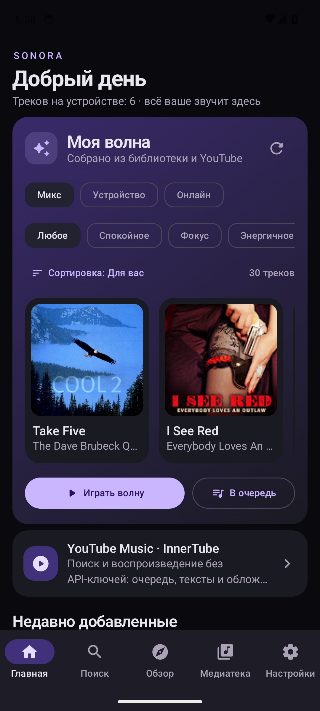 | 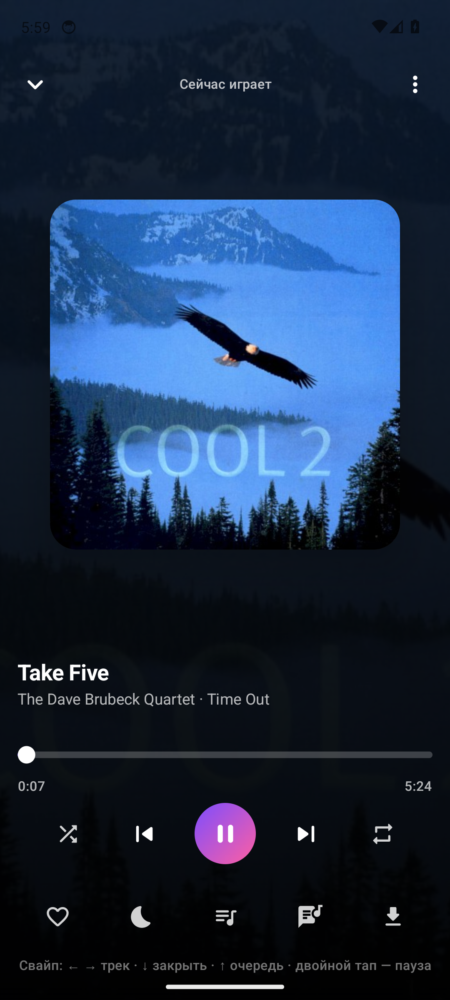 | 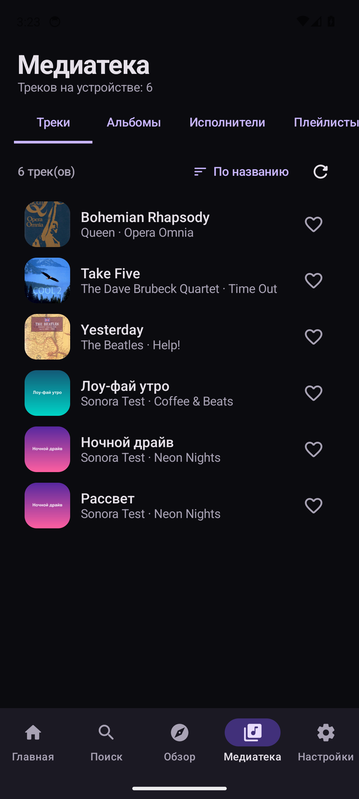 |

| Настройки | Подключения (InnerTube) | Поиск |
|---|---|---|
| 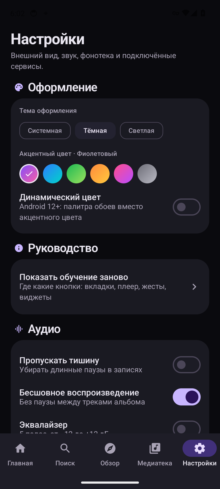 | 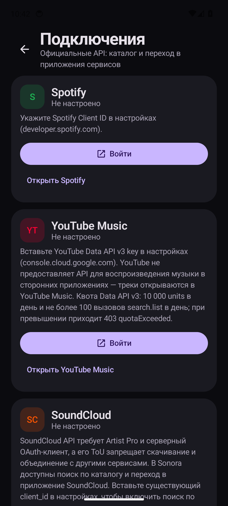 | 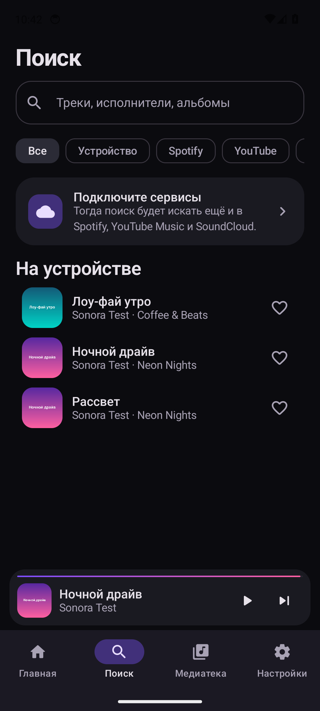 |

| Обзор: свободная музыка + скачивание | Синхронизированный текст (караоке) |
|---|---|
| 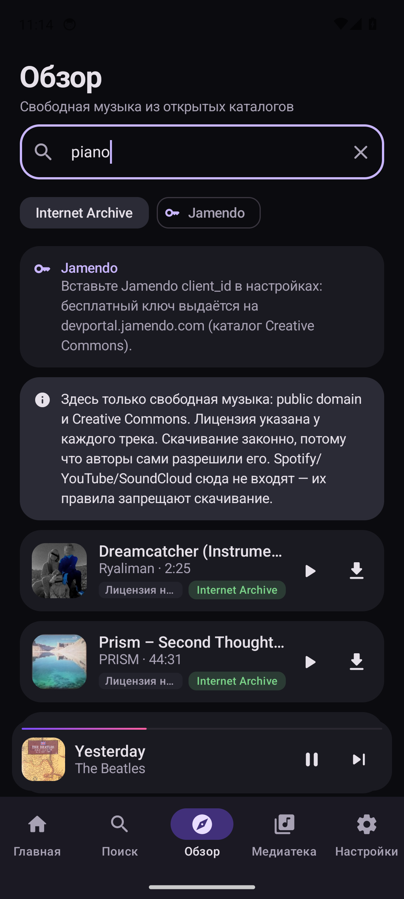 | 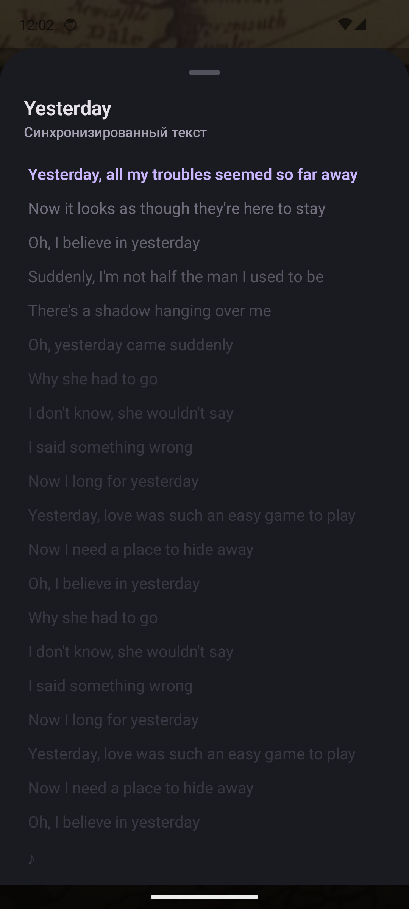 |

| Жесты в плеере | Виджет 4×2 (large) | Виджет 2×2 (small) |
|---|---|---|
| 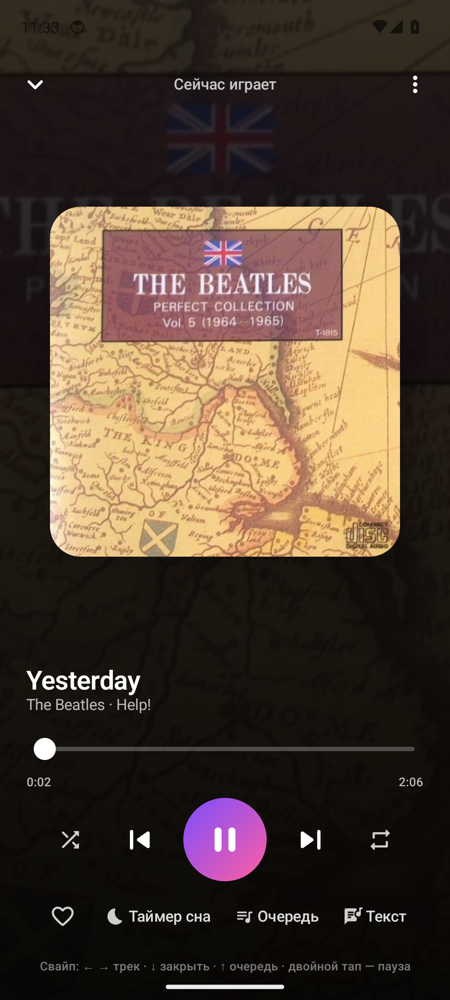 | 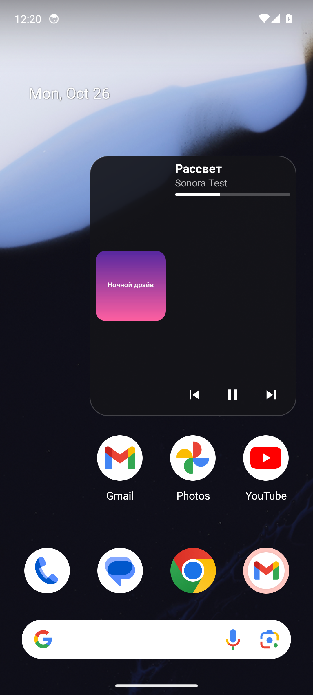 | 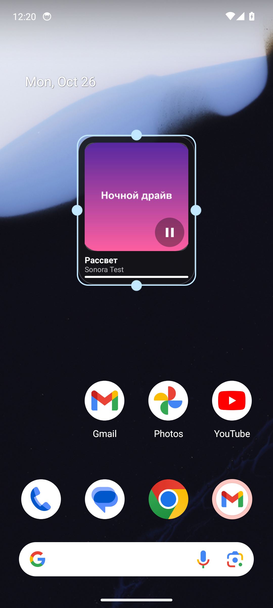 |

| YouTube Music в приложении | Импортированная библиотека YouTube |
|---|---|
| 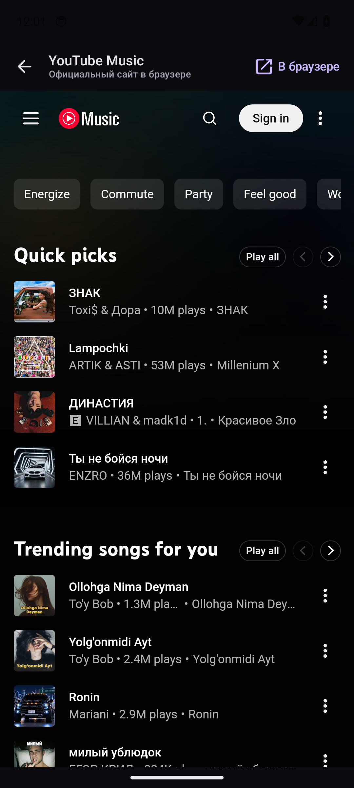 | 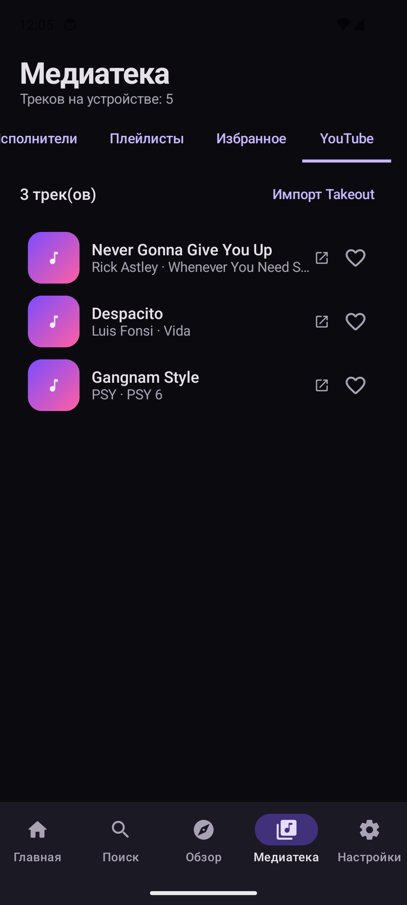 |

Светлая тема и авто-очередь: [settings-light.png](docs/screenshots/settings-light.png), [queue.png](docs/screenshots/queue.png).

---

## Что приложение умеет

### Полноценный локальный плеер (это работает всегда и бесплатно)

| Возможность | Статус |
|---|---|
| Сканирование фонотеки через MediaStore (MP3/FLAC/Opus/AAC/OGG) | ✅ |
| Фоновое воспроизведение, уведомление, экран блокировки, Bluetooth-кнопки | ✅ Media3 `MediaSessionService` |
| Очередь с перемещением и удалением, shuffle, repeat | ✅ |
| Эквалайзер (5 полос), Skip silence, скорость 0.75×–2× | ✅ |
| Таймер сна (15/30/45/60 мин) | ✅ |
| Плейлисты, избранное | ✅ |
| Поиск по локальной фонотеке и YouTube Music | ✅ |
| Импорт файлов, копирование в свою папку `Music/Sonora` | ✅ |
| **Поиск и скачивание свободной музыки**: Internet Archive (без ключа) и Jamendo (CC) | ✅ |
| **Онлайн-метаданные**: альбом, год, обложка, фото и биография автора | ✅ MusicBrainz, CAA, iTunes, Deezer, TheAudioDB, Wikipedia, InnerTube |
| **Синхронизированные тексты песен** из LRCLIB: караоке-подсветка, автоскролл, тап — переход по строке | ✅ |
| **Автопоиск метаданных** после сканирования (включён по умолчанию) | ✅ |
| **Постоянный кэш метаданных**: найденное сохраняется на диск сразу и навсегда | ✅ |
| **Жесты в плеере**: свайп ←/→ — трек, ↓ — закрыть, ↑ — очередь, двойной тап — пауза | ✅ |
| **Виджет рабочего стола**: отдельные виджеты 2×2, 4×1, 4×2, 4×4 + авто-виджет, обложка | ✅ |
| **Автоматическая очередь**: похожие треки при запуске одного | ✅ |
| **Бесконечная очередь**: случайные треки, когда очередь заканчивается; порядок рандомизируется | ✅ |
| **YouTube Music через InnerTube**: поиск, плейлисты, очередь, тексты и аудиопоток | ✅ |
| **Вход в Google-аккаунт** через WebView: личные плейлисты и «Понравившиеся» | ✅ |
| **Скачивание треков YouTube** в приватную папку с обложкой, артистом и альбомом | ✅ |
| **Сохранение любого играемого трека**: InnerTube, прямые URL, открытые каталоги | ✅ |
| **Импорт плейлиста из файла** CSV/JSON/M3U/TXT (Spotify, Apple Music, YouTube Music) | ✅ |
| **Моя волна** на главной: источники, настроения, сортировка, микс локального и онлайн | ✅ |
| **Очередь сохранённых**: избранное, «Понравившиеся» YouTube, плейлисты аккаунта | ✅ |
| **Тексты как в Metrolist**: крупный караоке-визуал, плавная подсветка и автоскролл | ✅ |
| **Импорт плейлиста YouTube по ссылке** (PL…, OLAK5uy_…, `?list=…`) | ✅ |
| **Встроенный YouTube Music** (WebView для личной библиотеки и входа в Google) | ✅ |
| **Импорт библиотеки YouTube Music из Google Takeout** (CSV/ZIP, без API-ключей) | ✅ |
| Оформление в духе Metrolist: Material 3 Expressive, тёмная тема, 6 акцентов, динамический цвет | ✅ |

### YouTube Music на InnerTube

| Что | Как работает |
|---|---|
| **Поиск** | `music.youtube.com/youtubei/v1/search` с фильтром «песни»: трек, исполнитель, альбом, длительность, обложка |
| **Плейлисты** | `browse` по `VL…` + продолжения; импорт по ссылке или из Google Takeout |
| **Воспроизведение** | InnerTubeX из Metrolist: перебор клиентов, дешифровка `signatureCipher`, PoToken через WebView/BotGuard; играет ExoPlayer |
| **Скачивание** | MP4-поток InnerTubeX сохраняется в приватную папку, обложка — рядом; трек становится локальным |
| **Сохранение** | Кнопка «Скачать» работает и для InnerTube, и для прямых URL: трек и обложка попадают в библиотеку |
| **Импорт списка** | CSV/JSON/M3U/TXT из Spotify, Apple Music или YouTube Music → поиск в библиотеке и InnerTube → плейлист |
| **Аккаунт** | WebView-вход в Google → cookie/SAPISIDHASH → личные плейлисты и «Понравившиеся» |
| **Очередь «дальше»** | `next` + automix-плейлист: очередь не обрывается после одного трека |
| **Тексты** | вкладка Lyrics из `next` + `browse` (`MPLYt…`), LRCLIB для синхронного текста |

Ключи Google Cloud, OAuth-клиент и квоты YouTube Data API больше не используются и удалены из интерфейса.

### Чего здесь нет и почему

- **Нет обхода DRM и рекламы.** InnerTube используется для воспроизведения и
  личного офлайн-доступа; DRM не обходится.
- **Скачивание YouTube — для личного офлайна.** Файлы лежат в приватной папке приложения
  и не распространяются. Скачивание из YouTube нарушает условия сервиса; ответственность
  за использование лежит на пользователе.
- Подробный разбор ограничений с источниками: [docs/PLATFORM-FACTS.md](docs/PLATFORM-FACTS.md).

---

## Технологии

- **Kotlin 2.4.20**, **AGP 9.4.1**, **Jetpack Compose** (BOM 2024.06.00), Material 3
- **Media3 / ExoPlayer 1.3.1** + `MediaSessionService` (фон, уведомление, Android Auto-совместимая сессия)
- **InnerTubeX v0.11.0** (GPL-3.0) — движок потоков YouTube Music из Metrolist: cipher, SABR, PoToken-контракты
- **PoToken WebView** (порт из Metrolist, GPL-3.0): BotGuard-токены через скрытый WebView
- **Google-аккаунт** (WebView + cookie/SAPISIDHASH) для плейлистов и «Понравившихся»
- **Скачивание InnerTube**: MP4 → приватная папка + обложка; локальный трек с метаданными
- **Navigation Compose**, `StateFlow`-архитектура, ручной DI (без Hilt)
- **OkHttp 4.12**, **kotlinx.serialization**, **Coil** для обложек, **Ktor** для InnerTubeX
- Хранилище: JSON в `filesDir` (библиотека/плейлисты/настройки), OAuth-токены — `EncryptedSharedPreferences`
- `minSdk 26`, `targetSdk 34`, `compileSdk 37` (Android 17)

## Структура проекта

```
app/src/main/java/app/sonora/
├── SonoraApp.kt            Application, владелец AppGraph
├── AppGraph.kt             ручной DI-контейнер + маршрутизация OAuth-колбэков
├── MainActivity.kt          Edge-to-edge, deep link sonora://oauth/*, разрешения
├── core/
│   ├── model/Models.kt      Track, Playlist, Album, Artist, Source, ConnectionState
│   ├── net/                 Http (OkHttp) и OAuth PKCE
│   ├── settings/            AppSettings + SettingsStore (StateFlow + JSON)
│   ├── security/            SecureStore (EncryptedSharedPreferences)
│   └── util/                AppLinks (deep links), Formatters, JsonFile
├── data/
│   ├── library/             MediaStoreScanner, LibraryRepository
│   ├── discover/            DiscoverSource, DiscoverRepository, ArchiveDiscoverSource, JamendoDiscoverSource
│   ├── metadata/            MetadataLookup, MetadataService (MusicBrainz / Cover Art Archive / LRCLIB)
│   ├── remote/              MusicSource / ConnectableSource / SourceRegistry
│   │   ├── spotify/         OAuth PKCE + Web API (код остался, UI отключён)
│   │   ├── youtube/         YouTubeSource на InnerTube + пакет innertube/
│   │   │                    (InnerTube, InnerTubeApi, InnerTubeXEngine, InnerTubeStreams)
│   │   └── soundcloud/      официальный API (метаданные)
│   ├── import/              TakeoutImporter — библиотека YouTube Music из CSV/ZIP
│   └── download/            DownloadManager (свой/свободный контент)
├── playback/                PlaybackService (ExoPlayer + MediaSession), InnerTubeDataSource,
│                            PlaybackController, AudioEffectBus
├── widget/                  SonoraWidget, SonoraWidgetProvider (RemoteViews)
└── ui/
    ├── MainScreen.kt        нижняя навигация (5 вкладок), мини-плеер, маршруты
    ├── MainViewModel.kt     единая ViewModel
    ├── theme/               цвета, типографика, формы, акценты
    ├── nav/Routes.kt
    ├── components/          TrackRow, CoverArt, MiniPlayer, EmptyState, LyricsSheet
    └── screens/             Home, Search, Discover, Library, Player, Queue, Settings,
                             Connections, Details, YouTubeWebScreen
```

## Установка

- **APK**: скачайте `Sonora-x.y.z-debug.apk` из раздела **Releases** и установите
  (разрешите установку из неизвестных источников).
- **Через adb**:

```bash
adb install -r Sonora-0.5.0-debug.apk
```

- **Из исходников** — см. раздел [Сборка](#сборка).

Требуется Android 8.0 (API 26) и новее. Debug-APK подписан debug-ключом — для публикации
соберите release с собственным keystore (см. [docs/SETUP.md](docs/SETUP.md)).

## Сборка

Полная инструкция — [docs/SETUP.md](docs/SETUP.md). Коротко:

1. Android Studio (последняя стабильная) + **JDK 21**.
2. `File → Open` → папка `Sonora`, дождаться Gradle sync.
3. InnerTube работает без настройки: ключи и OAuth не нужны.
4. `Run ▶` на устройстве Android 8.0+.

```bash
./gradlew :app:assembleDebug        # APK в app/build/outputs/apk/debug/
./gradlew :app:lintDebug            # статический анализ
```

Gradle wrapper (9.7.1) лежит в репозитории, отдельно ставить Gradle не нужно — достаточно JDK 21.
При первом запуске wrapper скачает сам Gradle, Android SDK 37 и зависимости (нужен интернет).

## Документация

- [docs/README.md](docs/README.md) — полный индекс документации
- [docs/SETUP.md](docs/SETUP.md) — установка, Takeout, виджет, типовые ошибки
- [docs/ARCHITECTURE.md](docs/ARCHITECTURE.md) — слои, потоки данных, InnerTube, воспроизведение, OAuth
- [docs/DOWNLOADS.md](docs/DOWNLOADS.md) — сохранение треков: InnerTube, прямые ссылки, каталоги, ошибки
- [docs/METADATA.md](docs/METADATA.md) — источники метаданных, авторы, фото, биографии, обложки
- [docs/GOOGLE-ACCOUNT.md](docs/GOOGLE-ACCOUNT.md) — вход в Google, личные плейлисты, приватность
- [docs/DISCOVERY.md](docs/DISCOVERY.md) — открытые каталоги (Archive.org, Jamendo), лицензии, лимиты
- [docs/TAKEOUT.md](docs/TAKEOUT.md) — импорт библиотеки YouTube Music из Google Takeout
- [docs/IMPORT.md](docs/IMPORT.md) — импорт своей музыки файлами и плейлистов из других сервисов
- [GITHUB.md](GITHUB.md) — данные для публикации репозитория и релиза на GitHub
- [docs/WARP.md](docs/WARP.md) — WARP-туннель: конфиги, перебор, только трафик Sonora
- [docs/LYRICS.md](docs/LYRICS.md) — синхронизированные тексты (LRC, караоке)
- [docs/WIDGET.md](docs/WIDGET.md) — виджет: размеры, обложка, обновление
- [docs/LEGAL.md](docs/LEGAL.md) — что можно и нельзя, кратко и по-русски
- [docs/PLATFORM-FACTS.md](docs/PLATFORM-FACTS.md) — детальный разбор API и ToS с источниками
- [docs/INTEGRATIONS.md](docs/INTEGRATIONS.md) — как устроены интеграции
- [docs/UI.md](docs/UI.md) — дизайн-система и экраны
- [docs/ROADMAP.md](docs/ROADMAP.md) — планы и направления
- [CHANGELOG.md](CHANGELOG.md) — история версий
- [CONTRIBUTING.md](CONTRIBUTING.md) · [SECURITY.md](SECURITY.md) · [CODE_OF_CONDUCT.md](CODE_OF_CONDUCT.md)

## Статус и лицензия

Версия **0.9.6**. Проверено в среде разработки:

- `gradlew :app:assembleDebug` — **BUILD SUCCESSFUL**, APK в `app/build/outputs/apk/debug/`;
- **WARP на главном экране**: статус и кнопка «Подключить/Выключить» без похода в Настройки;
- **импорт своей музыки**: файл `import-test.mp3` выбран через системный пикер → «Импортировано: 1»,
  трек появился в «Недавно добавленных», библиотека пересканирована; инструкция — диалог
  на Главной и [docs/IMPORT.md](docs/IMPORT.md);
- **бесконечная «Моя волна»**: «Ещё рекомендации» → 29 → 49 треков, без повторов (исключение
  по `id` и `исполнитель|название`);
- **метаданные из семи источников**: MusicBrainz, Cover Art Archive, iTunes, Deezer,
  TheAudioDB, Wikipedia и InnerTube, плюс LRCLIB для текстов. Обложки до 1000×1000,
  фото и биография автора; проверено на `Billie Jean`: альбом «Thriller» (1982),
  обложка iTunes 1000×1000, провайдеры в кэше — «MusicBrainz / LRCLIB / iTunes»;
- **скачивание InnerTube**: bounded-range поток InnerTubeX, резервный player-поток,
  сброс кэша ссылки при 403/410/416 и понятная причина ошибки;
- **«Моя волна» — только музыка**: в подборке нет клипов/концертов (фильтр по названию и
  длительности), 29 треков, подпись «Только музыка: без видео и концертов»;
- **свайпы на мини-плеере**: влево → следующий трек, вправо → предыдущий, вверх → полный
  плеер; работает на любой вкладке (проверено: Yesterday → Рассвет свайпом влево);
- **автоперебор WARP**: при выбранном битом конфиге приложение перешло на следующий —
  статус «Подключён», «Попытка 2 из 2», в журнале `WARP connected via config=… endpoint=engage.cloudflareclient.com:2408`;
- **обучение новичков**: 5 экранов при первом запуске и повторный запуск из Настроек;
- **плеер**: иконки без подписей в один ряд, собственный слайдер, кнопки «скачать»/«текст»;
- `gradlew :app:testDebugUnitTest` — **18 тестов**: смоук-тесты InnerTube (поиск,
  плейлист, поток `itag=251`, очередь «дальше», текст, MP4-поток), парсер импорта
  и нормализация авторов;
- **метаданные применяются**: на реальном треке (Bohemian Rhapsody, Queen) после обогащения
  появились обложка Cover Art Archive, обычный и синхронизированный текст, MBID; альбом
  «Music» из MediaStore заменён на реальный (`Opera Omnia`); список Медиатеки обновился;
- **полный набор виджетов** зарегистрирован (2×2, 4×1, 4×2, 4×4 + авто-виджет);
- **кнопка «вперёд»**: 10 переключений подряд → очередь выросла, воспроизведение продолжилось
  (active item id 0 → 10), залипаний нет;
- **кэш метаданных**: повторный запуск в авиарежиме сразу показал «Все треки уже заполнены»;
  сетевые сбои больше не кэшируются как «ничего не найдено» (отрицательный TTL 6 ч);
- локальный плеер, свайпы, бесконечная очередь, YouTube Music на InnerTube, импорт Takeout и
  плейлистов по ссылке, караоке-тексты, скачивание с обложками, «Моя волна», вход в Google.

Что ещё не сделано — [docs/SETUP.md](docs/SETUP.md#7-статус-сборки-и-известные-ограничения).

## Участие

Проект открыт для PR и Issue. Перед стартом прочитайте [CONTRIBUTING.md](CONTRIBUTING.md)
и [CODE_OF_CONDUCT.md](CODE_OF_CONDUCT.md). Планы — в [docs/ROADMAP.md](docs/ROADMAP.md),
история — в [CHANGELOG.md](CHANGELOG.md). Об уязвимостях — приватно, по [SECURITY.md](SECURITY.md).

## Лицензия

[GPL-3.0](LICENSE) © 2026 Sonora contributors. Проект использует **InnerTubeX** (MetrolistGroup,
GPL-3.0), поэтому распространяется под GPL-3.0. Остальные библиотеки — под своими лицензиями
(AndroidX/Compose — Apache-2.0, Media3 — Apache-2.0, OkHttp — Apache-2.0, Coil — Apache-2.0,
kotlinx.serialization — Apache-2.0, Ktor — Apache-2.0). Подробности — [THIRD-PARTY-NOTICES.md](THIRD-PARTY-NOTICES.md).
